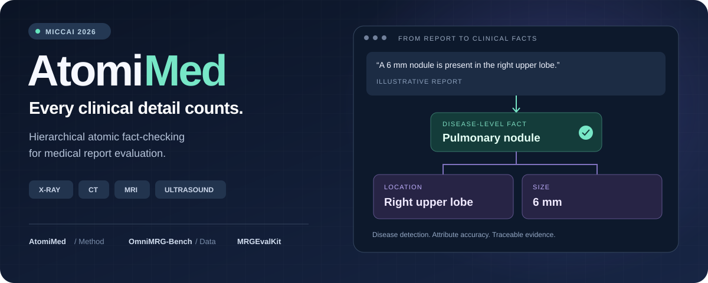
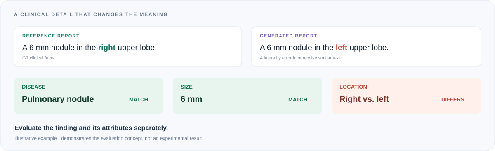
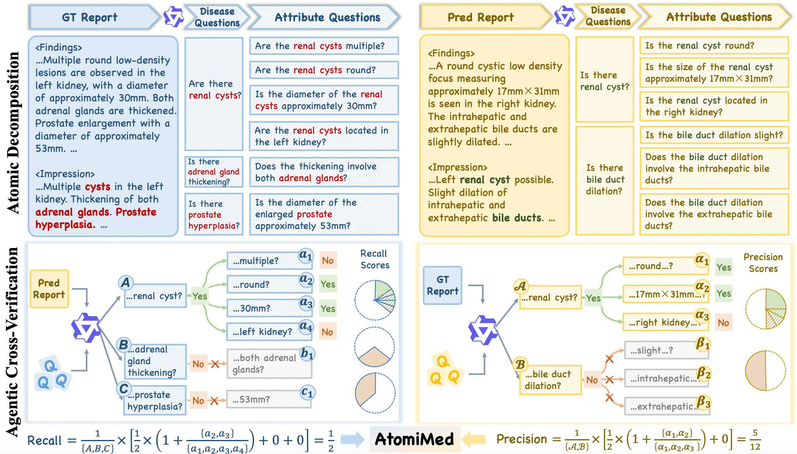
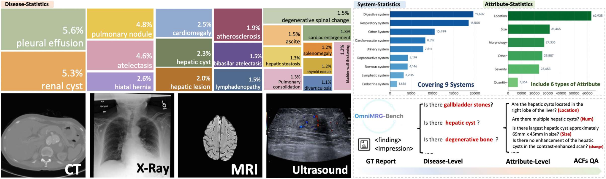

<div align="center">



### Hierarchical Atomic Fact-Checking for Universal Clinical-Aware Medical Report Evaluation

**MICCAI 2026** · AtomiMed / OmniMRG-Bench / MRGEvalKit

[**📄 Paper**](https://papers.miccai.org/miccai-2026/0077-Paper2351.html) &nbsp; · &nbsp; [**🤗 Dataset**](https://huggingface.co/datasets/Venn2024/OmniMRG-Bench) &nbsp; · &nbsp; [**📚 Springer**](https://doi.org/10.1007/978-3-032-38079-1_2) &nbsp; · &nbsp; [**⚡ Quick start**](#quick-start) &nbsp; · &nbsp; [**✍️ Citation**](#citation)

</div>

---

**AtomiMed evaluates the clinical facts inside a medical report.** It decomposes reports into disease-level and attribute-level questions, then checks their consistency in both directions. This separates finding detection from descriptive accuracy and makes errors traceable to individual questions.

| **AtomiMed** | **OmniMRG-Bench** | **MRGEvalKit** |
| --- | --- | --- |
| The evaluation method | The multimodal benchmark | The code and evaluation toolkit |

## One detail can change the meaning



## Explore OmniMRG-Bench

**The GT Hierarchical QA release is available on Hugging Face.** Start with nested report annotations, or load a flat table of individual questions.

| GT reports | Clinical QA pairs | Datasets | Modalities |
| :---: | :---: | :---: | :---: |
| **13,855** | **261,576** | **8** | **4** |

<div align="center">

<a href="https://huggingface.co/datasets/Venn2024/OmniMRG-Bench"><strong>🤗 Browse and download OmniMRG-Bench →</strong></a>

</div>

| Modality | Datasets |
| --- | --- |
| X-ray | MIMIC-CXR · IU-Xray · CheXpert |
| CT | CT-RATE · AMOS · Merlin |
| MRI | RadGenome-Brain-MRI |
| Ultrasound | Ultrasound |

<sub>Numbers describe the current HF GT QA release. See its dataset card for annotation versions, empty-QA flags and source terms.</sub>

## Quick start

```bash
pip install datasets
```

```python
from datasets import load_dataset

reports = load_dataset(
    "Venn2024/OmniMRG-Bench", "hierarchical", split="test"
)
sample = reports.filter(lambda row: not row["qa_empty"])[0]

print(sample["ground_truth_report"])
print(sample["disease_qa"])
print(sample["attribute_qa"])
```

Use `"flat"` for one QA per row, or `"variants"` to inspect alternative stored annotations. All three configurations use the `test` split.

## How AtomiMed works

**1 · Decompose** — extract disease questions and finding-specific attribute questions from reference and generated reports.

**2 · Cross-check** — use each report as evidence to answer questions extracted from the other report.

**3 · Measure** — compute precision and recall at both levels, aggregate them into F1, and retain question-level evidence.

<a href="assets/readme/paper-method.png"></a>

<sub>Figure 1 from the paper. Click to view the original at full resolution.</sub>

<details>
<summary><strong>Explore the benchmark overview from the paper</strong></summary>



Figure 2 from the paper. These are the paper's benchmark statistics; the release counts shown above are computed from the current Hugging Face export.

</details>

## Work with MRGEvalKit

The repository provides model adapters, report-generation dataset loaders and export utilities. The hosted GT QA can be used independently through the quick start above. Local inference setup and the current implementation gaps are documented in the [repository guide](docs/repository-guide.zh-CN.md).

<details>
<summary><strong>Installation and report-generation entry points</strong></summary>

```bash
git clone https://github.com/Venn2336/MRGEvalkit.git
cd MRGEvalkit
unzip models.zip
unzip utils.zip
pip install -r requirements_qwen3.txt
```

Use a compatible Linux / NVIDIA GPU environment for inference. Before launching, configure model weights and dataset paths, and resolve the known import and path issues listed in the guide.

- **CLI entry:** `eval.py`
- **Multi-GPU launcher:** `eval_chunked.sh`
- **Model registry:** `LLMs.py`
- **Dataset dispatch:** `benchmarks.py`

GT QA data, report-generation outputs and final AtomiMed scores are different artifacts. The current root-level workflow exports generated and reference reports; refer to the [code guide](docs/repository-guide.zh-CN.md) for the published scoring-code boundaries.

</details>

## Citation

If you use AtomiMed, OmniMRG-Bench or MRGEvalKit, please cite our **MICCAI 2026** paper:

```bibtex
@InProceedings{WanYua_AtomiMed_MICCAI2026,
  author    = {Wang, Yuan and Chang, Wanxing and Jiang, Songtao and Gao, Shujian and Zhang, Xiaotian and Yuan, Ruifeng and Cao, Weiwei and Shi, Bowen and Zhang, Ling and Liu, Zuozhu and Zhang, Jianpeng},
  title     = {{AtomiMed}: Hierarchical Atomic Fact-Checking for Universal Clinical-Aware Medical Report Evaluation},
  booktitle = {Medical Image Computing and Computer Assisted Intervention -- MICCAI 2026},
  year      = {2026},
  publisher = {Springer Nature Switzerland},
  volume    = {LNCS 16882},
  month     = {September}
}
```

[Official MICCAI citation](https://papers.miccai.org/miccai-2026/0077-Paper2351.html) · [Download BibTeX](CITATION.bib)

---

<div align="center">

**AtomiMed** — Every clinical detail counts.

[Paper](https://papers.miccai.org/miccai-2026/0077-Paper2351.html) · [Dataset](https://huggingface.co/datasets/Venn2024/OmniMRG-Bench) · [Code](https://github.com/Venn2336/MRGEvalkit)

</div>
